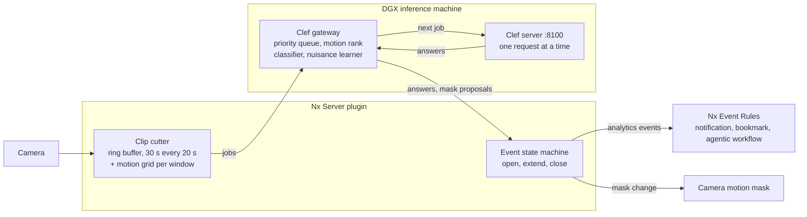

# PRD: Clef Video Questions for Nx Meta

2026-10-14 · Darren Odom · Status: Draft v3 (adds motion priority, nuisance learning, camera knowledge and zones)

## Summary

Clef Operator lets an Nx Meta operator ask plain-language questions about every camera, such as "is anyone fighting?" or "is the lens dirty?". It answers them continuously with Clef, which runs on a local GPU, and shows each answer in Nx as an analytics event.

Answers have to arrive fast enough to act on. Video is cut into 30 s windows that start every 20 s, so consecutive windows overlap by 10 s. Each question is sampled at the frame rate it needs, up to 10 fps. Urgent questions run ahead of routine ones, and motion is the main signal for which windows go first. Inference is local and free per request, so the scheduler sends work whenever the model is free.

The system also learns what is not worth watching. When motion keeps appearing without anything the operator cares about, Clef is asked what is moving, such as a flag, a tree or headlights. The system then proposes or applies a change to the camera's motion mask.

Clef knows each camera: its name, what the operator says about it, and a profile the system learns over time of what the camera normally sees by hour and day. Operators can draw named zones on a camera, such as "back door" or "fire lane", and ask questions about one zone only.

The integration has two settings pages. At the system level, an administrator sets where inference runs, the defaults, what the site cares about, the known sources of nuisance motion, and questions that apply to every camera. At the camera level, an operator sets that camera's questions, each question's settings, overrides, and how the motion mask may be changed.

## Goals, non-goals and success metrics

**Goals**

1. Any camera can carry plain-language questions, set for one camera or for the whole system.
2. Answers reach Nx as analytics events that Nx rules can act on: notifications, bookmarks, HTTP calls to agentic workflows.
3. The time from something happening to the event in Nx is as short as the window design allows.
4. Clef chooses each question's frame rate (1 to 10 fps) and priority; an operator can override both.
5. Motion decides which windows run first, and windows with no motion skip questions that need movement.
6. Nuisance motion (flags, trees, shadows, headlights, rain, spider webs) is identified by Clef and reduced by changing the motion mask.
7. Every request tells Clef which camera it is looking at and what that camera normally sees, learned from its own answers over time.
8. Operators can draw named zones on a camera and ask questions about a zone only.
9. The local model is kept busy, and urgent questions are never stuck behind routine ones.

**Non-goals for v1**

- Bounding boxes and object tracking. Clef returns probabilities, not locations. Motion cells give rough location only.
- Captions or free-text descriptions. Clef answers typed questions only. It cannot write new questions; the system builds nuisance questions from a catalog (see Motion and nuisance learning).
- A cloud inference path. Cloudflare's hosted Clef can be added later behind the same endpoint setting.
- Running more than one inference server, or splitting load across several.

**Success metrics**

| Metric | Target | How measured |
| --- | --- | --- |
| Detection latency, critical questions (event starts to Nx event) | median 15 s or less, p95 25 s or less | Staged clips with known event times |
| Critical windows answered on time | 99% or more | Scheduler log: answered vs skipped |
| Model busy time when the queue is not empty | 95% or more | Server request log |
| Precision on the pilot question set | 0.8 or more at the default threshold | Labelled pilot footage |
| Time from saving a question to its first answer | 60 s or less | Settings change log vs first event |
| Nuisance motion events per camera per day, after 7 days of learning | 50% fewer than before | Nx motion event count, before vs after |

## Users and example questions

- **System administrator.** Points the system at the inference server, sets defaults, site interests, known nuisance sources and system-wide questions, and watches capacity.
- **Security operator.** Adds questions to individual cameras, tunes their thresholds, reviews mask suggestions, and responds to the events.
- **Integrator or workflow builder.** Connects events to Nx rules, bookmarks and HTTP calls to agentic workflows.

| Example question | Answer type | Expected priority | Expected fps | Needs motion |
| --- | --- | --- | --- | --- |
| Is anyone fighting? | True/false | Critical | 8 to 10 | Yes |
| Is someone holding a weapon late at night? | True/false | Critical | 4 to 6 | Yes |
| Has a person fallen and stayed on the ground? | True/false | High | 4 | Yes |
| Is a vehicle parked in the fire lane? | True/false | Normal | 1 to 2 | No |
| How crowded is the lobby? | Scale: empty, light, busy, packed | Normal | 2 | No |
| Is the flag waving? | True/false | Low | 2 | Yes |
| Is a spider web in view? | True/false | Maintenance | 1 | No |
| Is the lens dirty or blurred? | True/false | Maintenance | 1 | No |

**Worked example (hallway camera).** Windows 0:00–0:30 and 0:20–0:50 come back negative. Window 0:40–1:10 returns fight = 0.90, above the threshold. The plugin opens a "fight" event on the hallway camera for 0:40–1:10. An Nx rule then sends a notification, adds a bookmark and calls an agentic workflow. Window 1:00–1:30 either keeps the event open or closes it.

## Pipeline

Three parts:

- An Nx Server plugin cuts each camera's stream into overlapping 30 s clips, reads the Server's motion data, and turns answers into Nx events.
- A gateway on the inference machine owns the priority queue, the classifier and nuisance learning.
- The existing Clef server answers one request at a time.



Every Nx Server sends jobs to the one gateway, so priority holds across the whole system.

**1. Nx Server plugin (C++, Nx Analytics SDK).** It is device-independent and runs as one Engine per Server, with one DeviceAgent per enabled camera.

- **Input.** Compressed video plus the Server's motion metadata: `streamTypeFilter: compressedVideo|motion`. It uses the secondary stream unless a question needs more frames per second than the secondary stream delivers; then it uses the primary stream (see Adaptive frame rate).
- **Buffer.** Each DeviceAgent keeps a ring buffer of about 40 s of H.264/H.265 packets and the matching motion grids.
- **Clips.** Every 20 s it closes a window: the last 30 s, with the start moved back to the nearest keyframe. It remuxes the window into an MP4 without re-encoding. A 30 s secondary-stream clip is about 0.7 MB on the test system.
- **Motion summary.** Each window carries the share of frames with motion, a 44 × 32 motion heat map, and whether motion started inside the window after a quiet period.
- **Jobs.** For each window, questions are grouped by frame rate, priority and zone. Each group becomes one job sent to the gateway, which makes it one Clef request carrying all of that group's questions. Questions on different zones need different crops, so they never share a request.
- **Events.** Answers come back to the DeviceAgent, which updates each question's event state and emits Nx event metadata (see Nx integration).

**2. Clef gateway (new service, on the inference machine).** It sits in front of the existing Clef server, at `http://192.168.87.134:8100` today.

- It holds one priority queue for every Nx Server, so priority is enforced system-wide.
- It resamples each clip to its job's frame rate and shrinks frames to about 0.1 MP (448 × 252 for 16:9), Clef's token floor. M0 showed no accuracy loss and a third less model time.
- It ranks jobs by class, then motion, then deadline; drops jobs that are too old to matter; and merges duplicates (see Priority and scheduling).
- It runs the question classifier that picks frame rate, priority and whether a question needs motion.
- It runs the nuisance learner and produces mask proposals (see Motion and nuisance learning).
- It checks a bearer token, and it reports queue depth, model busy time and skipped jobs to the system settings page.

**3. Clef server (exists).** `POST /v1/systemone` with `state`, `questions`, `videos` and a per-request `video_fps`. Question types are `noul` (true/false), `choice` and `score` (ordered scale). It runs one request at a time and takes about 6 minutes to load after a restart.

**What each request carries.** The `state` gives:

- the camera name, the operator's description of it, and its learned profile for this hour and day (see Camera knowledge);
- the zone name and description, when the questions target a zone;
- the site's interests and the known nuisance sources;
- the local time and the day of the week. Time matters: "weapon late at night" depends on it.

The question texts go in `questions`, and the window's MP4 goes in `videos`, cropped to the zone when there is one.

**Answer to event.** The plugin keeps one state machine per camera and question.

- **Open.** An event opens when an answer crosses the question's on-threshold. True/false questions use P(true). Choice questions use the summed probability of the options marked "alert on". Scale questions use the probability at or above the alert level.
- **Stay open.** It stays open while later windows remain above a lower off-threshold.
- **Close.** It closes after a set number of windows in a row fall below that off-threshold; the default is 1. A skipped no-motion window counts as below for questions that need motion.

Because windows overlap by 10 s, one incident usually spans two or three windows. The state machine reports it once, as one event with a start and an end.

## Adaptive frame rate

Each question gets the lowest frame rate that can still see what it asks about. Clef picks that rate once, when the question is saved; the operator can override it. The rate is one of 1, 2, 4, 6, 8 or 10 fps.

**How Clef picks.** When a question is saved, the plugin calls the gateway's classify endpoint. The gateway sends Clef one text-only request with three questions:

- **`fps`** (choice): how fast does the thing change, and how briefly does it appear? Options: "stays for minutes (1 fps)", "changes over tens of seconds (2 fps)", "changes within a few seconds (4 fps)", "brief, fast motion (8 fps)", "split-second action (10 fps)". 6 fps is kept for manual overrides.
- **`priority`** (score): see Priority and scheduling.
- **`needs_motion`** (noul): can the answer only be yes when something in view is moving? Fighting: yes. Dirty lens: no.

The chosen rate is the option with the highest probability. If the top two options are within 0.1, the higher rate wins, because missing an event costs more than extra frames. The probabilities are stored and shown on the camera page.

**Source frame rate.** A question can never get more frames than the stream has. On the test system, the Front porch secondary stream runs at about 6.3 fps (640 × 360 H.264), and the primary at 25 fps (2560 × 1440 H.265). When a camera has a question above its secondary stream's rate, its windows for that group come from the primary stream, and the gateway downsizes them. The camera page shows the effective rate when the stream caps it.

**Why rate matters for cost (measured, see [M0 results](M0_RESULTS.md)).** A frame costs about 75 tokens once shrunk to about 0.1 MP (more at full size), and the model takes about 0.53 s per 1,000 tokens. A 30 s window takes about 2.5 s at 2 fps and about 26 s at 10 fps at full size. All fit Clef's 64,000-token cap, but one camera at 10 fps uses more than the whole GPU, so 8 to 10 fps can only be used in short bursts.

**Behaviour.**

- Questions at the same rate and priority on one camera share a single request.
- An operator override always beats Clef's choice and is marked "manual" in the UI.
- An administrator can set a system-wide maximum rate (default 10).
- Changing a question's text runs the classifier again unless its settings are manual.

**Caveat.** Clef was trained at 2 fps, and other rates are untested. In the server tests, Clef described a moving shape's color correctly but got its direction wrong. M0 must show that 8 to 10 fps improves detection of fast events such as fights. If it does not, the default ceiling drops to 4 fps.

## Priority and scheduling

The gateway keeps the model busy and always runs the most urgent job next. Motion is the main signal inside a class: a window where something moves goes ahead of a still one, and a still window skips questions that need motion.

| Class | Examples | Max age before a job is dropped | When the queue is backed up |
| --- | --- | --- | --- |
| Critical | Fighting, weapon, forced entry | None, never dropped | Every window with motion runs |
| High | Person down, tailgating | 60 s | Every window runs while it is still current |
| Normal | Vehicle in fire lane, crowding | 30 s | Only the newest window per camera runs |
| Low | Flag waving, nuisance checks | 30 s | Only the newest window runs, using leftover capacity |
| Maintenance | Dirty lens, spider web, camera moved | 1 h | At least one answer per camera per hour |

**How Clef classifies priority.** A score from maintenance to critical with this instruction: "How urgently would a security operator need to act if the answer were yes? Consider harm to people, then property, then equipment upkeep." The site's interests from the system page are included in the state, so "we care about vehicles after hours" raises vehicle questions. A borderline call goes to the higher class.

**Motion rank.** Each window has one of three motion ranks, taken from the Server's motion data:

| Motion rank | Meaning | Effect |
| --- | --- | --- |
| Onset | Motion started inside this window after at least 60 s of quiet | Goes first in its class. An extra window is cut 10 s after onset, so the first answer does not wait for the 20 s cadence |
| Active | Motion in at least 5% of frames, in cells that are not known nuisance | Normal order in its class |
| Still or nuisance-only | No motion, or motion only in cells marked as nuisance | Questions that need motion are skipped and count as "no". Other questions run in normal order |

Motion for a question is counted per frame (frames with any motion inside its zone, or anywhere for the whole frame). It is active at 5% of the window's frames, or with half a second of continuous motion: a car crossing in a couple of seconds is continuous but small, while noise is scattered single frames.

Because Clef answers 20–35 s after the moment, cameras that record on objects only need a pre-record of at least 45 s, so the recording reaches back to the moment itself.

**Scheduling rules.**

1. **Next job.** Every job has a latency target from the moment it reaches the gateway: Critical 8 s, High 12 s, Normal 16 s, Low 20 s (motion onset tightens it by a quarter; Maintenance has none). The job due first runs first, so jobs that arrive together run in class order, and a waiting Low job is not starved by a stream of fresh High ones.
1a. **One request per camera window and zone.** A window's question groups are gathered for 0.3 s and sent to Clef once per zone, at the highest frame rate and priority asked for, with all their questions; each caller gets its own answers.
2. **Pipelining.** One request runs on the model at a time. The gateway prepares the next job while the current one runs.
3. **Staying on time.** Before each pick the gateway simulates the queue with a cost model learned from Clef's answers (fixed time plus time per token; tokens from frames). If a job would miss its target, the lowest-priority job ahead of it that can give up frames is lowered a step (to 2, then 1 fps). High stops at 2 fps; Critical stops at 2 fps and is only lowered to keep another Critical job on time. Low and Maintenance jobs are capped at 2 fps. The status reports latency per class (median, 95th percentile, share on time) and how many jobs were lowered. Replaying the busiest morning of the dev site, every class was answered within its target at up to twice that load.
4. **Merging.** For Normal, Low and Maintenance, a newer window for the same camera and group replaces an older one still queued. Skipped windows are counted, not hidden.
5. **Aging.** A Maintenance job waiting 45 minutes moves up to Normal, before its 1 h maximum age, so each camera still gets an answer within the hour.
6. **Overload.** If Critical jobs alone use more than 90% of model time for 5 minutes, the gateway reports "over capacity", on the system page and as an Nx event.
7. **No fixed interval.** Windows close every 20 s (plus onset windows), and the model takes the next job as soon as it is free. When the queue is empty, the model is idle.

## Motion and nuisance learning

Motion that keeps firing without anything the site cares about is nuisance. The system finds out what it is with Clef, then masks it out of motion detection, so motion keeps meaning something.

**What the administrator tells the system (system page).**

- **What matters here.** Free text, for example "people or vehicles on the property after 22:00; anyone near the back door". It is added to every request's state and to the priority classifier.
- **Known nuisance sources.** A list, for example "the flag on the driveway pole", "trees along the back fence", "headlights from the street at night", "spider webs on the porch camera". These become catalog entries for nuisance checks and are listed in every request's state as things to ignore.

**When a nuisance check runs.** A window has "unexplained motion" when motion is active but no question opens or holds an event, and no person, vehicle or animal was found in it. For each unexplained window (at most one per camera per 5 minutes), the gateway adds a Low-priority nuisance job:

1. It finds the motion cells from the window's heat map and crops the clip to their bounding box.
2. It asks Clef a `choice` question: "What is causing the movement in this clip?" The options are the site's known nuisance sources, the built-in catalog (trees or plants in wind, a flag or banner, shadows or changing light, vehicle headlights, rain, snow or fog, insects or a spider web near the lens, camera shake, water or reflections), and the real-activity options "a person", "a vehicle", "an animal", "nothing visible".
3. If one nuisance source wins in the same cells three times in a row, the gateway adds a specific `noul` question for that camera, for example "Is the motion a flag waving?" It then uses this cheaper question for those cells.

Clef cannot write new question text. The system builds questions from the site's list and the built-in catalog, and Clef chooses among them. An optional local LLM could suggest new catalog entries; that is an open question, not v1.

**From answers to a mask change.** Each camera's motion cells are grouped into clusters. A cluster becomes a mask proposal when all of these hold:

- the same nuisance source won with probability 0.8 or more in at least 5 windows spread over at least 2 hours;
- the cluster had no "a person", "a vehicle" or "an animal" answer in the last 7 days;
- the change would not take masked cells above 25% of the grid, and does not touch any "always watch" region the operator drew.

**Mask modes (system default, camera override).**

| Mode | What happens |
| --- | --- |
| Off | Nuisance checks still run and are shown, but the mask is never changed |
| Suggest (default) | A `nx.clef_operator.nuisance` event says what was found and which cells, for example "Top-left motion is trees moving (0.91, 7 windows). Mask 12 cells?" The camera page shows the proposal with Apply and Dismiss |
| Auto | The proposal is applied right away, and the event says so. The previous mask is saved and a Revert button restores it |

**How the mask changes.** Nx stores the camera motion mask as rectangles on a 44 × 32 grid (`sensitivity,x,y,w,h;...`, where sensitivity 0 masks a cell). The plugin writes the new mask through the Nx REST API (`PATCH /rest/v3/devices/{id}`, field `motion.mask`). It can either lower sensitivity (the default first step) or mask cells fully on a second proposal. Every change is logged with the before and after masks.

**Guardrails.**

- A mask changes only motion detection. Clef still sees the whole frame, so critical questions on a masked area keep working; they just lose the motion boost there.
- Once a week, each masked cluster gets one nuisance check. If it now shows a person, a vehicle or an animal, the cells are unmasked and the operator is told.
- Changing the mask also changes Nx's own motion recording and motion events for that camera. The camera page says so next to the mode setting.

## Camera knowledge

Clef gets a short profile of the camera with every request, so the same question means the right thing on each camera. "Is anyone here?" should be routine on a busy front porch at noon and urgent in an empty basement at 03:00. The profile has three layers.

| Layer | Source | Example |
| --- | --- | --- |
| Identity | Nx camera name, plus the operator's description on the camera page | "Front porch. Covered porch facing the street; front door on the left." |
| Learned baseline | The system's own answers, summarized per hour of day and weekday or weekend | "Usually 0–1 people 07:00–21:00, none at night. Cars pass on the street often. A dog is seen most mornings." |
| Known nuisance | Nuisance learning (above) | "Flag on the pole, top left, moves in wind. Headlights sweep the porch at night." |

**How the baseline is learned.** Clef cannot write descriptions, so the baseline is built from structured answers and turned into text by a template.

1. **Profile survey.** Once an hour per camera, at Maintenance priority and 1 fps, the gateway asks a fixed set of scene questions: scene type (indoor or outdoor, lighting), how many people (score: none, one, a few, many), vehicles moving or parked, animals present, and activity level.
2. **Every other answer counts too.** Answers to the operator's questions, and real-activity answers from nuisance checks, are added to the same tallies.
3. **Tallies.** For each camera, the gateway keeps counts per hour of day (0–23) and day type (weekday or weekend), with older days weighted down (half-life 14 days). Motion share per hour is kept from the Server's motion data.
4. **Profile text.** The template writes the most common answers for the current hour slot into two or three sentences, with confidence words ("usually", "sometimes", "rarely") from the tallies. It writes nothing for a slot with fewer than 5 days of data.

**How the baseline is used.**

- **State.** The identity, the baseline for the current hour slot, and the known nuisance go into every request's state, in that order, kept under 120 words.
- **Priority.** When an answer is unusual for this hour slot (for example, people present at 03:00 where the baseline says "rarely"), the next windows for that camera get the Onset motion rank for 2 minutes, so they go first in their class.
- **Camera page.** The current profile text is shown read-only, with a Reset button that clears the learned tallies (for example, after the camera is moved).
- **Camera moved.** If the survey's scene answers change sharply from the baseline for a day (indoor turns to outdoor, or lighting class changes), a Maintenance event "camera view changed" is sent and the profile restarts.

## Zones

Operators can draw named zones on a camera and point questions at one zone. "Is anyone at the back door?" then looks at the back door, not at the whole yard.

- **Defining zones.** The camera page has a list of up to 8 zones. Each has a name, an optional description ("back door, inward-opening, badge reader on the right"), and a shape drawn on the video (PolygonFigure).
- **Questions on a zone.** Each question has a Zone setting: whole frame (default) or one of the camera's zones. System questions can be set to "whole frame" only, since zones are per camera.
- **What Clef sees.** The gateway crops each frame to the zone's bounding box plus a 10% margin, and grays out pixels outside the polygon. Small, distant zones become larger in the 512 × 512 frames Clef sees, which helps with small details. The state names the zone and gives its description.
- **Motion per zone.** The window's motion heat map is clipped to the zone, so motion rank and "needs motion" skipping use only motion inside that zone. Motion elsewhere in the frame does not wake up a zone question.
- **Events.** The event caption adds the zone, for example "Back door: Is anyone at the door?", so Nx rules can filter on it.
- **Mask guardrail.** Zones that carry Critical or High questions count as "always watch": nuisance learning never masks them.

## PTZ hunter

On a PTZ camera, the hunter moves the camera to wherever a question is most likely to be answered "yes", and keeps moving until it is. Example targets: "Is there a person here?", "Is this a wide shot that includes people?". It works only on cameras whose PTZ the Nx Server can drive; the gateway checks this before it starts.

**How it hunts.**

1. **Survey.** The camera visits a grid of views across its range at wide zoom (by default pan steps of 0.2 across the full range, at two tilts). At each view the gateway takes a snapshot and asks Clef, in one request:
    - the hunt questions themselves;
    - likelihood questions, built from the hunt questions and the site's interests: "Are people likely to gather here?", "Does this look like a place people enter or leave, such as a door, gate, path or driveway?", "Could the thing asked about plausibly appear in this view?";
    - negative prompts, views to stay away from: always "Is most of this view vegetation?", "Is the view blocked by tree branches or leaves close to the camera?", "Is most of this view sky?" and "Is most of this view a wall, roof, eaves or the camera housing?", plus any the operator adds ("Also avoid").
2. **Score.** Each view's scene score is how much open ground a person could stand on, scaled down by the strongest blocker (a nearby wall, a roof or pergola below, sky) and by half the foliage. Negative prompts also weigh on every choice of where to go next: a view's value is its yield times (1 − its avoid score), so a view that is partly trees or wall is visited less even after people have been seen there, and a view with no chance of a yes is never chosen for hunting: one whose avoid score is 0.8 or more, or, where the target has never been found, one that is mostly wall, roof or sky (built-in blockers 0.5 or more), shows little open ground (scene score under 0.15), or whose avoid answers reach 0.7. The operator's own "also avoid" questions count where they stand out from that camera's usual answer (a camera that always sees some trees does not avoid everything).
2b. **Helper questions and zooming in.** Operators list helper questions on the camera page ("Look closer at places with": a path, a gate, a play area, a seating area), places where the hunt questions are more often yes. They are asked with the scene questions; a view's score rises only where an answer stands out from the camera's usual answers. Every 6 hours the hunter asks each tile of a promising wide view the helper questions, and each tile where one stands out from the view's other tiles becomes a zoomed view (half the field of view) that the hunter visits and learns like any other.
2c. **Wide and close, and boredom.** The hunter works in cycles of about 4 minutes: the first share (camera page, default 75%) zoomed all the way out, the rest "looking around" at zoomed views (two levels, about half and a quarter of the wide field of view), best value first. If no zoomed view is worth a look it stays wide. It also gets bored of places: every recent visit (the last 60, fading with a 10-minute half-life) scales down the appeal of views near it, more with each visit (so boredom can never make a hopeless view win), so it drifts to other areas that are likely to show the target instead of returning to the best view again and again. Pan and tilt move slowly; zoom is silent, so it moves in one step, and after a zoom the hunter waits for the camera to refocus (default 4 s) before any command or snapshot.
2a. **Learn.** Every look at a view adds evidence: the hunter's own snapshot answers, and the camera's own windows answered while the hunter held that view. A view's yield at an hour starts from its scene score and moves to what looks there actually showed, nearby hours counting less. A view looked at at least 12 times whose yield is under a quarter of the best view's is quiet: skipped, and rechecked every 3 hours.
3. **Hunt.** The hunter keeps choosing the next view by yield at this hour (relative to the best view), past hits, time since the last visit, a small exploration bonus, and magnet pull, minus a travel penalty. While the camera's own windows are arriving, it holds each view until one of them has been answered there (at most 52 s), and longer while they say yes; windows that overlap a move are dropped. A view that scores high adds its neighbours (a half step either side) and a tighter zoom to the candidates, so the hunter homes in on promising areas.
4. **Magnets.** Views operators care about pull the hunter back. The camera's resting view when the hunter starts is always a magnet; more can be listed on the camera page. The pull grows the longer the hunter has been away from every magnet (full strength after 10 minutes), so it drifts back between excursions.
5. **Found.** When a hunt question's answer reaches its threshold, the hunter stops and dwells on that view (default 60 s, renewed while the answer stays yes). The camera's normal 30 s windows then ask its questions as usual, so events and best shots come from the regular pipeline. The hunter also raises an Nx generic event ("Clef PTZ hunter", with the view and question) that rules can act on.
6. **Hand-back.** Outside active hours, or when the hunter is turned off, the camera returns to its home preset.
6b. **Embedding map and search.** An embedding model (EmbeddingGemma 2) runs next to Clef. Every look's frame and its tiles are embedded and kept in a map of the camera's directions (pan, tilt, field of view). Plain-text search over the map ("picnic table", "the gate", "a parked car") shows where it matches and what matched, and "Look there" sends the hunter to that direction next. The same embeddings rule out hopeless views before Clef's scene questions and pick the tiles worth zooming into; Clef still asks the hunt questions on every look, because embeddings do not detect people reliably.
7. **Operators and auto-tracking come first.** Every 2 seconds, while it is not moving the camera, the hunter checks the camera is where it left it; during a move it checks that axes it is not driving stay put. If the camera has moved (more than 2.5 degrees of pan or tilt, or 10% of zoom), someone else is driving it: an operator's joystick or preset, or the camera's own auto-tracker following an object. The hunter stops at once, without sending even a stop command, and sends nothing (moves, snapshots or keep-alive) for the take-back time (camera page, default 10 s), restarting the count whenever the camera moves again. Then it carries on from wherever the camera was left; its wide/close-up cycle is paused meanwhile, so it still gets its full time looking around. Settings saved meanwhile keep the hand-over.

**Quiet movement.** PTZ motors are loud, so the hunter never jumps. Measured on Back PTZ, absolute moves ignore the requested speed (a 0.2 pan move takes about 1.1 s at any speed), but continuous moves honour it (about 0.11 pan units a second at full speed). The hunter therefore drives in continuous mode at a capped speed (default 0.1, about 2 seconds per 0.02), stops on arrival, rests between moves (default 20 s), sweeps the survey in one direction, and pays a travel penalty for long trips.

**Presets.** Nx lists the camera's preset IDs but not their positions, and activating a preset jumps at full speed (and on Back PTZ the activate call did not move the camera at all). So presets are not used as magnets automatically. Open question: allow a one-time, opt-in calibration that visits each hotkeyed preset once to record its position.

**Settings (camera page, PTZ hunter section).** Enable; hunt for (questions, ';'-separated); also avoid (extra negative questions); look closer at places with (helper questions); magnet views (pan,tilt[,zoom]); found-at threshold; maximum motor speed; rest between moves; dwell when found (capped at 10 minutes per stay); time zoomed all the way out; focus time after zooming; take back after an operator or auto-tracking; pan range; status (read-only).

**Cost.** One image request per view (about 0.5 to 1 s of model time), at Low priority, so hunting uses spare GPU time and never delays critical windows. With about 4 s per view (move, settle, ask), a 20-view survey takes under 2 minutes.

**Limits.** While the camera moves, its own motion detection fires everywhere; the hunter's moves are slow and short, and windows during a move are treated as camera motion, not scene motion (open question: tell the plugin when the camera is moving). Pan and tilt are the Nx normalized values (−1 to 1); how they map to degrees depends on the camera.

## Nx integration

Answers reach Nx as analytics events from a C++ Server plugin built on the Nx Analytics SDK ([Server Plugin SDK](https://meta.nxvms.com/docs/developers/knowledgebase/196-vmsname-server-plugin-sdk-c), [SDK downloads](https://meta.nxvms.com/download/releases/sdk)). Everything an operator does with them uses standard Nx features.

**Plugin structure** ([manifest spec](https://github.com/networkoptix/nx_open/blob/master/vms/libs/nx_sdk/src/nx/sdk/analytics/manifests.md))

- **Integration (Plugin).** Integration ID `nx.clef_operator`; declares the system settings model (`engineSettingsModel`).
- **Engine.** One per Server, device-independent. `streamTypeFilter: compressedVideo|motion`, `preferredStream: secondary`. Declares the camera settings model (`deviceAgentSettingsModel`) and a type library with the event types below.
- **DeviceAgent.** One per camera where the operator turns the plugin on. It buffers video and motion, sends jobs, emits events, and applies mask changes.

**Event types** ([taxonomy spec](https://github.com/networkoptix/nx_open/blob/master/vms/libs/nx_sdk/src/nx/sdk/analytics/taxonomy.md))

| Event type ID | Name in Nx | Flags | Emitted when |
| --- | --- | --- | --- |
| `nx.clef_operator.critical` | Clef: critical | `stateDependent` | A Critical question opens or closes an event |
| `nx.clef_operator.high` | Clef: high | `stateDependent` | A High question opens or closes an event |
| `nx.clef_operator.normal` | Clef: normal | `stateDependent` | A Normal question opens or closes an event |
| `nx.clef_operator.low` | Clef: low / maintenance | `stateDependent` | A Low or Maintenance question opens or closes an event |
| `nx.clef_operator.nuisance` | Clef: nuisance found | none | A nuisance source is identified, a mask is proposed, applied or reverted |
| `nx.clef_operator.health` | Clef: system health | none | Inference unreachable, over capacity, or windows being skipped |

Event types are grouped by class, not by question, because the type library is fixed in the manifest while questions are added at run time.

- **Caption:** the question, for example "Is anyone fighting?"
- **Description:** the answer, its probability, the span, the rate and the motion rank, for example "Yes · 0.90 · window 0:40–1:10 · 8 fps · motion onset".
- **`isActive`:** true while the event is open, false when it closes.
- **`key`:** camera ID plus question ID, so repeated "still active" reports are merged.

**Dashboard.** The gateway serves a page with the latest answer to every question on every camera (yes or no against the question's on-threshold, its probability, age, priority, frame rate and time to answer), Clef's load, latency per class and the PTZ hunters. It is added to Nx as a Web Page. Answers are not drawn on the video: an analytics object on every camera would make cameras that record on objects record all the time.

**What operators get with no extra work**

- **Rules.** Event Rules match "Analytics Event" by event type and caption text, and can notify, bookmark, or make an HTTP request to an agentic workflow.
- **Search.** Events show on the camera timeline and in the Notifications and Events panels.
- **Health.** The system health event can raise an alarm when inference stops.

**Not in v1.** Object metadata such as bounding boxes and tracks.

## System settings page

Engine settings model, shown under System Administration → Integrations, built from the SDK's [settings model](https://github.com/networkoptix/nx_open/blob/master/vms/libs/nx_sdk/src/nx/sdk/settings_model.md) controls.

| Group | Setting | Control | Default |
| --- | --- | --- | --- |
| Inference | Gateway URL | TextField | `http://192.168.87.134:8100` |
| Inference | Access token | PasswordField | empty, required before go-live |
| Inference | Test connection | Button | Shows model status, time per request, version |
| Inference | Status | Banner | Ready / loading / unreachable / over capacity |
| Site | What matters here | TextField (multi-line) | empty |
| Site | Known nuisance sources | TextField, one per line | empty |
| Windows | Window length | SpinBox, seconds | 30 |
| Windows | Overlap | SpinBox, seconds | 10 |
| Windows | Early window on motion onset | CheckBox | On |
| Windows | Video stream | ComboBox: auto, secondary, primary | Auto |
| Frame rate | Maximum fps for any question | ComboBox: 1, 2, 4, 6, 8, 10 | 10 |
| Frame rate | Default when Clef is unsure | ComboBox | 2 |
| Motion | Active-motion threshold | SpinBox, % of frames | 5 |
| Motion | Quiet period before onset | SpinBox, seconds | 60 |
| Nuisance | Mask mode | ComboBox: off, suggest, auto | Suggest |
| Nuisance | Max share of grid masked automatically | SpinBox, % | 25 |
| Nuisance | Evidence needed | SpinBox: windows / hours | 5 windows over 2 h |
| Events | Default on-threshold | DoubleSpinBox | 0.80 |
| Events | Default off-threshold | DoubleSpinBox | 0.50 |
| Events | Windows below off-threshold before close | SpinBox | 1 |
| Priority | Max age per class | SpinBox per class | As in the class table |
| Priority | Over-capacity alert level | SpinBox, % of model time | 90 |
| System questions | Question list | Repeater of question groups | empty |
| Capacity | Load over the last hour | Label | Model busy %, jobs per class, windows skipped per class |

System questions apply to every camera where the plugin is on. A camera can turn one off or override its settings.

## Camera settings page

DeviceAgent settings model, under Camera Settings → Integrations → Clef Operator.

**Camera context**

- **Camera description** (TextField). For example "School hallway; no one should be here after 22:00." The Nx camera name is added automatically.
- **Learned profile** (Label, read-only) and **Reset profile** (Button).
- **Extra nuisance sources for this camera** (TextField, one per line).
- **Active hours** (TextField, cron-style). Optional.

**Zones** (Repeater, up to 8)

- **Name** (TextField), for example "Back door".
- **Description** (TextField). Optional.
- **Shape** (PolygonFigure).

**Motion and nuisance**

- **Mask mode** (ComboBox: use system, off, suggest, auto).
- **Always watch** (PolygonFigure). Cells here are never masked.
- **Pending proposal** (Banner + Apply / Dismiss buttons). Shows the nuisance source, its probability, the evidence count and the cells.
- **Revert last mask change** (Button).
- **Nuisance log** (Label). The last 5 findings.

**Inherited system questions** (one row each): use on this camera, plus threshold, priority and fps overrides.

**Camera questions** (Repeater, up to 20, each a GroupBox)

| Field | Control | Notes |
| --- | --- | --- |
| Enabled | SwitchButton | Off keeps the question but stops sending it |
| Question | TextField | Plain language |
| Answer type | ComboBox: true/false, choice, scale | Clef `noul`, `choice`, `score` |
| Options | TextField, comma-separated | Choice or scale only |
| Alert on | TextField | Choice: options that open an event. Scale: lowest level that opens one |
| On / off threshold | DoubleSpinBox × 2 | Default to system values |
| Frame rate | ComboBox: Auto, 1, 2, 4, 6, 8, 10 | Auto = Clef's choice |
| Priority | ComboBox: Auto, Critical, High, Normal, Low, Maintenance | Auto = Clef's choice |
| Needs motion | ComboBox: Auto, yes, no | Auto = Clef's choice |
| Clef's choice | Label | For example "8 fps (0.71) · Critical (0.83) · needs motion (0.94)" |
| Zone | ComboBox: whole frame, Zone 1 … Zone 8 | The zone's name shows next to its number; the gateway crops to it |
| Active hours | TextField | Optional |

**Behaviour on save.** New or edited questions are classified within a few seconds, and the next window uses them, within 20 s of saving. Removing a question closes any event it has open.

## Latency and capacity

Most of the delay is waiting for the window to close: up to 20 s at 30 s / 10 s overlap. The motion-onset window cuts that to about 10 s for incidents that start after quiet. Inference time decides how many cameras one GPU can serve.

| Stage | Time | Source |
| --- | --- | --- |
| Wait for the window to close | 0 to 20 s (10 s after a motion onset) | Window design |
| Remux and upload a 30 s clip | under 1 s (target) | To be measured |
| Queue wait, Critical | at most one running request | Scheduling rule 3 |
| Inference, 30 s window | 2.5 s at 2 fps, 6.8 s at 6 fps (0.1 MP frames); 26.6 s at 10 fps full size | M0 |
| Emit the event to Nx | under 0.1 s (target) | To be measured |

**Capacity.** One request at a time, so capacity is a model-time budget. With t_g the model time for one request of group g on a camera:

```
cameras ≈ (20 s × 0.9) / Σ t_g
```

Motion gating stretches this: still windows skip every question that needs motion. Measured in M0: t_g is about 2.5 s at 2 fps, so one DGX serves about 7 camera-groups every 20 s at full load.

**Measuring.** Every job logs: window closed, job queued, request started, answer received, event emitted.

## Risks and open questions

| Risk | Impact | Mitigation |
| --- | --- | --- |
| Clef was trained at 2 fps and got motion direction wrong in tests | Fight or fall detection may be weak | M0 evaluation; ask what is happening, not which way it moved; 4 fps ceiling if 10 fps does not help |
| Secondary streams run at about 6 fps on this site | 8 to 10 fps questions need the primary stream, which is 25 fps at 2560 × 1440 | Auto stream choice per question group; gateway downsizes |
| One model, one request at a time | A few 10 fps cameras could use up the GPU | Grouping, motion gating, low classes capped at 2 fps, capacity warning |
| Auto-masking hides a real threat area | Missed motion events and recording | Suggest by default, 7-day no-person rule, 25% cap, always-watch regions, weekly re-check, Clef still sees the full frame |
| Clef needs about 64 GB of GPU memory; `qwen38` SGLang uses the same GPU | Starting `qwen38` takes the model offline | DGX dedicated to Clef; health event |
| The Clef server has no auth today | Anyone on the LAN or ZeroTier can use it | Gateway requires a token; Clef server bound to localhost behind it |
| Video leaves the Nx Server for the DGX | Privacy and site policy | LAN only, clips deleted after inference |
| A model restart takes about 6 minutes | No answers during that time | Health event and status banner |

**Open questions**

- [ ] Can Nx take an event timestamped at the window start, up to 30 s in the past?
- [x] Can the settings response update the page after a save, in Nx 6.1? Yes: the reply can carry a new model (used for zone names) and values (used for "Clef's choice").
- [ ] Is the Server's motion metadata available to the plugin when software motion detection is off on a camera? (It is on for the test camera, and the grid arrives with every frame.)
- [ ] Should Critical questions get a shorter step between windows (a 30 s window every 10 s), at 2× the model time?
- [ ] Should a local LLM propose new nuisance catalog entries, or write the camera profile text instead of the template?
- [x] Can a Repeater hold PolygonFigure items (one shape per zone) in Nx 6.1? Yes; the polygon's label is the zone name.
- [x] Zone names in each question's Zone list: done by rewriting the model in the settings reply.
- [ ] Which pilot cameras, and who labels the footage?

## Development environment

| Item | Value |
| --- | --- |
| Nx server | Ubuntu_main, `https://192.168.87.6:7001`, Nx Meta 6.1.2.42921, Ubuntu 24.04 x64, SSH alias `servy` (g++ 13, cmake 4.2, ffmpeg) |
| Cameras | 8 recording (Milesight and RTSP), e.g. Front porch `a16a3ea0-825d-f86c-ee22-c09792ceb261` |
| Live clip pull | `GET /media/{cameraId}.mkv?stream=1` with a bearer token from `POST /rest/v3/login/sessions` |
| Clef server | DGX `http://192.168.87.134:8100`, `GET /health`, `POST /v1/systemone` |

## Milestones

| Milestone | Scope | Gate to the next one |
| --- | --- | --- |
| M0 Feasibility | Time 30 s clips at 1 to 10 fps on the DGX; score labelled clips per pilot question | fps cost table measured; fast-action gain shown |
| M1 Clef gateway | Priority queue with motion rank, classifier, nuisance checks, token auth; offline replay (MP4 in, events out) | Replay meets the latency targets |
| M2 Plugin MVP | One camera, system page, motion input, events in Nx | A staged fight shows as an event in Nx |
| M3 Full configuration | Camera page, overrides, zones, learned camera profile, mask suggest/apply/revert, health events, capacity readout | Rules notify, bookmark and call a workflow; a mask proposal applies and reverts |
| M3b PTZ hunter | Survey, scoring, hunt loop, dwell, generic event, camera-page settings | Back PTZ finds and dwells on a person who is outside its home view |
| M4 Pilot | Pilot cameras at one site | Success metrics met: general release |

M0 comes first because the biggest risks are model accuracy and model time at 8 to 10 fps, and neither needs Nx to test. If M0 shows no gain above 4 fps, M1 to M4 go ahead with a 4 fps ceiling.
